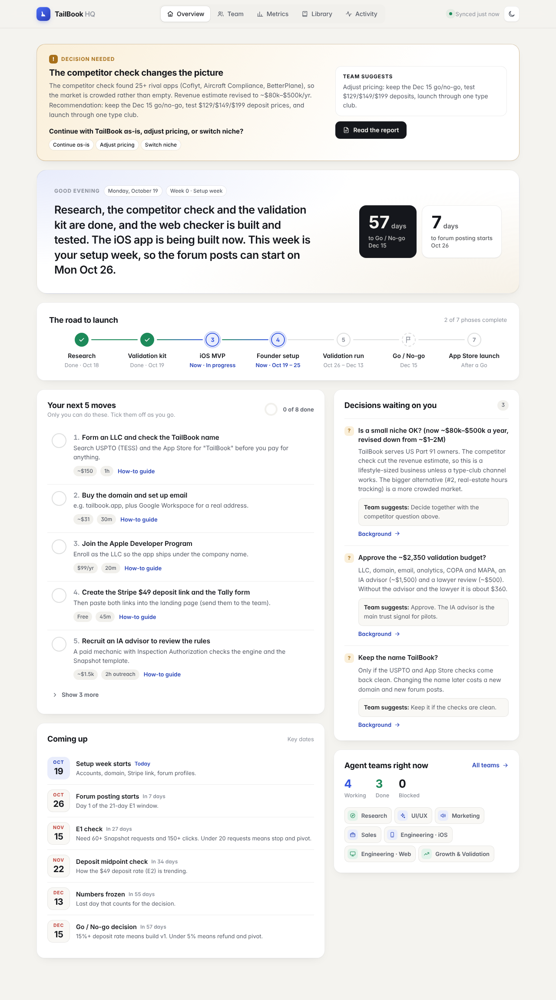

# TailBook HQ

Your founder dashboard. In one place you can see what each agent team is doing, what's done, what's next, what's waiting on you, and how the validation numbers look.

It runs on your own computer. Nothing is uploaded anywhere, and it reads the project files live, so it is always current.



## Run it on a Mac (first time, about 10 minutes)

1. **Install Node.js.** Go to <https://nodejs.org>, download the **LTS** installer for macOS, and open it. Click through the steps.
   (If you use Homebrew, `brew install node` works too.) You need version 22 or newer.
2. **Open Terminal.** Press ⌘ + Space, type `Terminal`, and press Return.
3. **Download the project.** Paste this and press Return (use the repo link the team gave you):
   ```sh
   git clone <repo-url> app-venture
   cd app-venture
   ```
   If macOS asks to install "command line developer tools" for `git`, click **Install** and run the command again afterward.
4. **Start HQ.**
   ```sh
   npm run hq
   ```
   No other install step is needed, because HQ has no dependencies.
5. **Open <http://localhost:4747>** in Safari or Chrome. Bookmark it.

Leave the Terminal window open while you use HQ. To stop it, click the Terminal window and press **Control + C**.

### Next time

```sh
cd app-venture
git pull        # get the teams' latest work
npm run hq
```

The page refreshes itself every 30 seconds, so you can leave it open.

### On your phone (optional)

HQ only listens on your Mac by default. To open it from a phone on the same Wi-Fi, start it with `HQ_HOST=0.0.0.0 npm run hq` and visit `http://<your-mac-name>.local:4747`. Only do this on a network you trust: anyone on that network could then see and tick your to-dos.

## What's on each page

| Page | What it shows |
|---|---|
| **Overview** | A decision that needs you now, a one-line "where we are", the road to launch, a countdown to the **Dec 15 go/no-go**, **your next 5 moves** (tick them off), decisions waiting on you, and key dates. |
| **Team** | One card per agent team: status (Working, Done, Blocked or Queued), what they're on, what's next, and how many files they've delivered. |
| **Metrics** | Experiments E1–E6, target versus actual, with green/amber/red bands. There's a form at the bottom to enter each week's numbers; it saves into `validation/06-experiment-tracker.csv`. |
| **Library** | Every document from every team, in a clean reader. |
| **Activity** | Recent saved changes (git commits) as a timeline. |

Ticking a to-do saves it to `hq/status.json`, so it stays ticked.

## For agents: how to update HQ

HQ reads `hq/status.json` on every request. To update the dashboard, edit that file and commit it. Keep it valid JSON (`node -e "JSON.parse(require('fs').readFileSync('hq/status.json','utf8'))"`).

- **Your team's status:** find your entry in `teams` (by `id`) and update:
  - `status`: one of `working`, `done`, `blocked`, `queued`;
  - `task`: one plain-English sentence about what you're doing now (the founder isn't technical: no jargon, no file paths);
  - `next`: what comes after, in a few words;
  - `updatedAt`: an ISO timestamp, e.g. `2026-10-20T14:05:00Z`;
  - `folders`: the repo folders that hold your deliverables (used for file counts and the "Open docs" link).
- **A to-do for the founder:** add to `todos`, with `id` (stable, kebab-case), `title`, `detail`, `cost`, `time`, `doc` (a repo path to the how-to guide) and `done: false`. Never flip `done` yourself; the founder does that.
- **A decision for the founder:** add to `decisions`, with `id`, `question`, `context`, `recommendation` and `doc`. Set `"decided": true` (and add `"answer"`) once the founder has answered it, and it disappears from the dashboard.
- **The banner at the top of Overview:** `headlineDecision` (`title`, `summary`, `question`, `options`, `recommendation`, `doc`). Remove the key or set `"decided": true` to hide it.
- **Where we are:** `headline` is the one sentence at the top of Overview. Rewrite it when the picture changes.
- **Phases and dates:** `phases[].status` is `done`, `active` or `upcoming`; `milestones` are `{ id, date: "YYYY-MM-DD", title, detail }`.

Deliverable counts, the Library and Activity are read straight from the repo folders and `git log`, so they need no updates.

The metrics come from `validation/06-experiment-tracker.csv`. HQ's form only ever writes the `actual_week` and `actual_cumulative` columns. Agents can edit other columns directly, but don't rename the headers.

## For developers

```
hq/
  server.mjs        Zero-dependency Node HTTP server (port 4747, PORT to override)
  lib/markdown.mjs  Small, HTML-escaping Markdown renderer
  lib/csv.mjs       CSV parse/serialize + experiment-tracker model and validated updates
  public/           index.html, app.css, app.js (no CDN, no build step)
  status.json       Dashboard state (teams, to-dos, decisions, milestones)
  test/             node --test API tests  →  npm run test:hq
  screenshots/      Every view at 1280px and 390px, light and dark
```

API: `GET /api/status`, `GET /api/metrics`, `GET /api/files`, `GET /api/doc?path=`, `GET /api/git`, `POST /api/todo {id, done}`, `POST /api/metrics {updates:[{row, week, experiment, metric, actual_week?, actual_cumulative?}]}`.

Safety: doc paths are confined to the repo's department folders, and dotfiles, `..`, absolute paths and symlinks that point outside are all refused. Markdown is escaped before formatting. Writes need a JSON body from the same origin, and the server binds to 127.0.0.1 by default.
